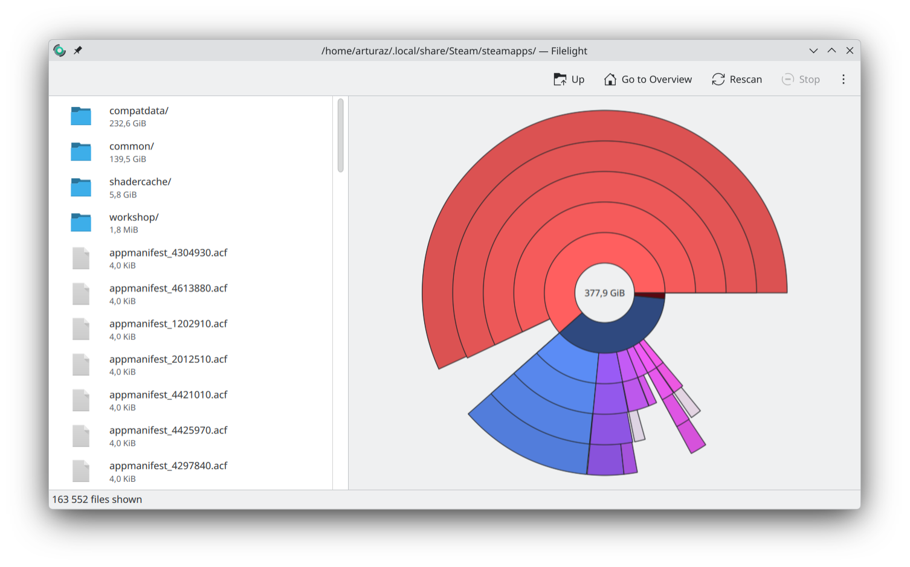
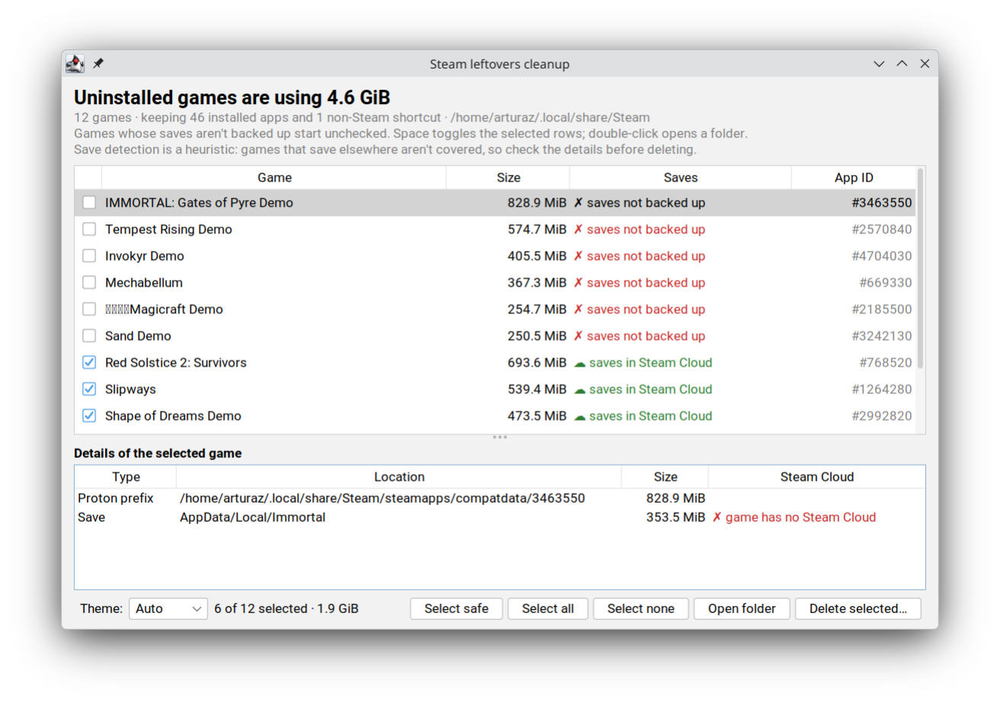

# steam-compatdata-cleanup

When you uninstall a game, Steam on Linux leaves its Proton prefix (`steamapps/compatdata/<appid>`) and shader cache
(`steamapps/shadercache/<appid>`) behind. These can add up to many gigabytes. This script finds the leftovers for
games that are no longer installed and removes them. It also warns you about save files that Steam Cloud has not
backed up.

For example, here `compatdata` takes 232.6 GiB of a 377.9 GiB `steamapps` directory, much more than the installed
games in `common` (139.5 GiB):





## Requirements

- [scala-cli](https://scala-cli.virtuslab.org/install). It downloads Scala and the dependencies on the first run. The
  script uses your Java (`JAVA_HOME`, then `java` on `PATH`) if it is version 17 or newer and not a headless build. If
  it is missing, older, or headless, scala-cli downloads JDK 21 once. When the script was not started from a terminal and takes
  more than a second to start (the first run downloads and compiles), it shows a "Starting…" notification until the
  program is up (`notify-send`, or a `zenity` progress window; a notification on macOS). If scala-cli is missing, the script prints the install link and exits. When it was not started from a
  terminal (for example by double-clicking it in a file manager), it shows the link in a dialog instead, using
  `kdialog`, `zenity`, `xmessage` or `notify-send`, whichever is available (`osascript` on macOS). Because desktop
  launchers often do not load your shell's `PATH`, the script also looks for scala-cli in the usual install locations
  (coursier, SDKMAN!, Nix, Homebrew, `~/.local/bin`, `/usr/local/bin`).
- Linux with native Steam at `~/.local/share/Steam`, or another Steam directory passed with `--steam-dir`.

## Usage

```sh
./cleanup.scala                  # GUI: pick the games to delete
./cleanup.scala --theme dark     # GUI look (see below)
./cleanup.scala --cli            # dry run in the terminal: list what would be deleted
./cleanup.scala --interactive    # terminal: ask per game, delete the ones you confirm (also -i)
./cleanup.scala --delete         # terminal: delete everything listed, no questions
./cleanup.scala --steam-dir /path/to/Steam
```

### GUI

The GUI lists every uninstalled game with its leftover size and save status. Select a game to see its folders and
saves below the list. Games whose saves are not backed up start unchecked. Check the games you want to remove (Space
toggles the selected rows) and press **Delete selected…**. A confirmation lists any games whose saves would be lost.
Double-click a game or a save to open its folder.

If there is no display (for example over SSH), the script prints a dry run in the terminal instead.

`--theme` picks the starting look; the **Theme** dropdown in the window switches it live:

- `auto` (default): FlatLaf light or dark, following the desktop's dark mode. The script reads the freedesktop
  appearance portal, then GNOME settings, then KDE's colour scheme, then `GTK_THEME`.
- `light`, `dark`, `darcula`, `intellij`: FlatLaf themes.
- `gtk`, `metal`, `nimbus`: the JDK's built-in looks.

On tiling Wayland compositors such as Hyprland (including Omarchy), sway and niri, Java windows stay blank unless
`_JAVA_AWT_WM_NONREPARENTING=1` is set. When the script detects one of these and the variable is not set, it restarts
itself with the variable set.

### Terminal

`--cli` only lists what would be deleted, so run it first to review. In interactive mode you answer `y` (delete),
`N` (skip, default), `a` (delete this and all remaining) or `q` (quit).

## What gets deleted

An app counts as installed if any Steam library (from `steamapps/libraryfolders.vdf`) has
`steamapps/appmanifest_<appid>.acf`. The script lists every `compatdata` or `shadercache` directory whose app is not
installed. It always keeps:

- non-Steam shortcuts (from `userdata/*/config/shortcuts.vdf`),
- appid `0`.

If no appmanifests are found at all, the script refuses to continue, since everything would look orphaned.

## Save detection

The script looks for likely save data in each prefix under `drive_c/users/steamuser`: `AppData/Local`,
`AppData/LocalLow`, `AppData/Roaming`, `Documents` and `Saved Games`. It skips entries that Wine and Proton create
themselves. For each save it checks the game's Steam Auto-Cloud rules and the last sync state, and puts the game in one
of three groups:

- **✗ Saves not backed up**: deleting the prefix loses these saves for good. Back them up first if you care.
- **☁ Saves backed up by Steam Cloud**: Steam restores them on reinstall.
- **✓ No save data found**

The GUI lists the not-backed-up games first, and interactive mode asks about them first.

Save detection is a heuristic. Games that keep saves elsewhere, for example in the install directory or under
Steam's `userdata`, are not covered. Check the list before you delete.

Game names and cloud information come from Steam's local caches (`appcache/appinfo.vdf`,
`userdata/*/config/localconfig.vdf`). The script makes no network requests.

## License

[Blue Oak Model License 1.0.0](LICENSE.md).
